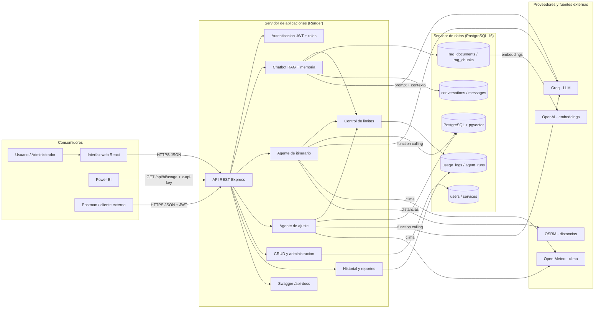
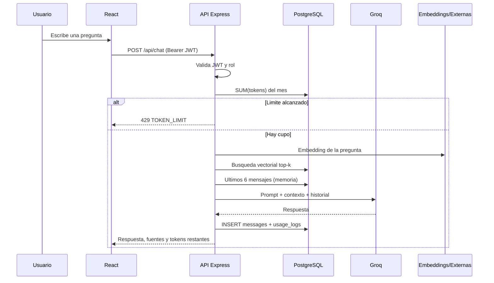
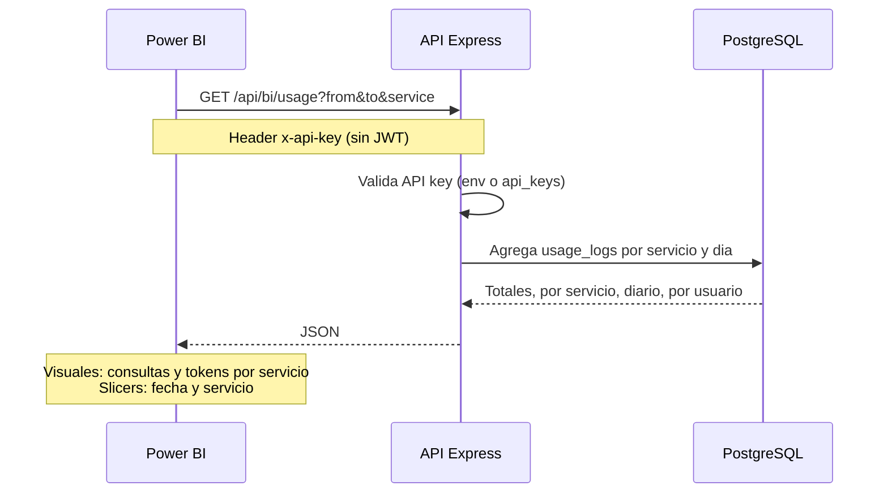
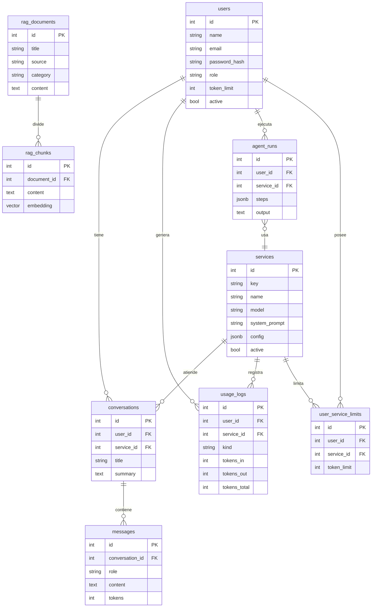

# Arquitectura - Web IA Turismo

## 1. Diagrama general

## 2. Recorrido de una solicitud desde la GUI

## 3. Recorrido desde un consumidor externo (Power BI)

El mismo endpoint y las mismas agregaciones alimentan el reporte web del administrador, garantizando resultados coincidentes.

## 4. Modelo de datos

## 5. Decisiones de arquitectura

- **Monorepo** con workspaces: un solo despliegue en Render sirve la API y el build de React, evitando CORS y simplificando CI/CD.
- **PostgreSQL + pgvector** como base de datos y Data Warehouse: almacena datos operativos, corpus RAG, historial y consumo.
- **Groq** para generacion y *function calling*; **OpenAI** para embeddings (Groq no los ofrece).
- **Open-Meteo y OSRM** como fuentes externas sin API key, usadas por los agentes.
- **Control de consumo** calculado desde `usage_logs` (fuente unica de verdad) para que web, API y Power BI coincidan.
- **Fallback BM25** cuando no hay `OPENAI_API_KEY`, manteniendo el sistema demostrable en cualquier entorno.

## 6. Seguridad

- JWT con expiracion; middleware de autenticacion y verificacion de rol.
- Contrasenas con bcrypt (pgcrypto en el seed).
- API keys hasheadas (SHA-256) para consumidores externos; la clave de BI puede definirse por variable de entorno.
- Validacion de entrada con Zod y manejo centralizado de errores.
- Limites de tokens verificados antes de cada ejecucion.
